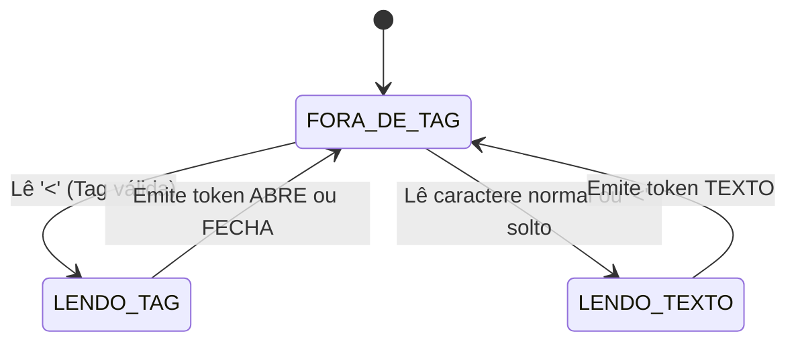
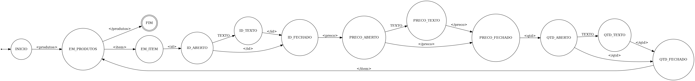
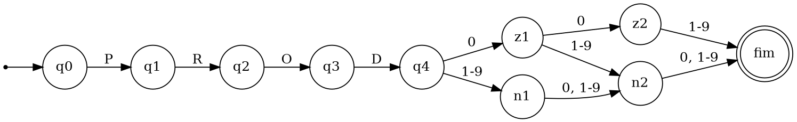
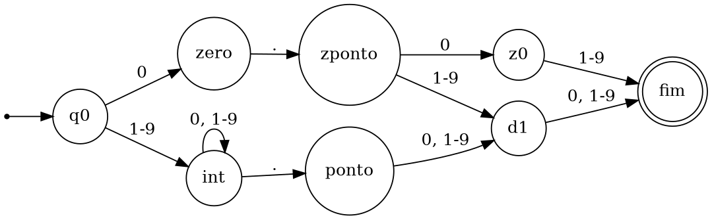
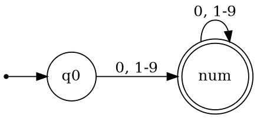

# Validador-de-Estrutura-XML-Plana
O objetivo é validar um arquivo XML que armazena itens de estoque de uma loja.

## Requisitos

Python 3.9 ou superior (testado no 3.12). Para rodar os testes: `pip install pytest`.

## Como executar

```bash
python main.py arquivo.xml              # mostra o primeiro erro (ou "XML válido.")
python main.py arquivo.xml --relatorio  # também grava todos os erros em erros.txt
python -m pytest -q                     # roda todos os testes
```

Exemplo válido do enunciado:

```xml
<produtos>
 <item><id>PROD999</id><preco>149.90</preco><qtd>15</qtd></item>
 <item><id>PROD123</id><preco>25.00</preco><qtd>200</qtd></item>
</produtos>
```

Saída: `XML válido.`

### Mensagens

| Situação | Saída |
|---|---|
| Arquivo vazio ou só com espaços | `Erro: Arquivo xml vazio` |
| `<produtos>` não aberto ou não fechado | `Erro sintático: Elemento < produtos > não foi aberto.` (ou `não foi fechado.`) |
| `<item>` com estrutura errada | `Erro de validação na linha N: Estrutura inválida em <trecho>.` |
| Campo com tipo errado | `Erro de validação na linha N: Tipo de dados inválido em <trecho>.` |

Na tela aparece só o primeiro erro (o de menor linha). Com `--relatorio`, todos os erros vão para `erros.txt`, e os de tipo trazem no fim quais campos falharam, por exemplo `[campos inválidos: qtd='-1' (linha 6)]`.

### Código de saída

| Código | Significado |
|---|---|
| 0 | XML válido |
| 1 | XML inválido |
| 2 | Não foi possível ler o arquivo (inexistente ou fora de UTF-8) ou uso incorreto |

## Estrutura do projeto

| Arquivo | Responsabilidade |
|---|---|
| `contrato.py` | Tipos compartilhados (`Token`, `Erro`, `Campo`, `Item`) e formatação das mensagens |
| `lexer.py` | Leitura do texto e geração de tokens com o número da linha |
| `estrutura.py` | AFD de estrutura (`<produtos>`, `<item>`, ordem `id`, `preco`, `qtd`) |
| `tipos.py` | AFDs de tipo (`id`, `preco`, `qtd`) |
| `afd_dot.py` | Gera os arquivos `.dot` dos AFDs |
| `main.py` | Integração e linha de comando |
| `testes/` | Testes automatizados e XMLs de exemplo |

## Decisões de projeto

- A estrutura é fixa (`produtos > item > id, preco, qtd`), então a linguagem é regular e um AFD basta: o projeto não usa pilha.
- `<produtos></produtos>` sem itens é válido.
- `preco`: duas casas decimais, mínimo `0.01`, sem limite superior e sem zero à esquerda (`007.50` é inválido).
- `qtd`: inteiro sem sinal e sem casas decimais; aceita `0` e zeros à esquerda (`007`).
- O texto dos campos não sofre `strip`: `" PROD001"` é rejeitado.
- Um erro dentro de um `<item>` não interrompe a leitura: o item é descartado e a validação segue no próximo (por isso o relatório lista vários erros). Um erro em `<produtos>` é fatal.

## Diagrama do Lexer (AFD)



Este diagrama modela o comportamento do lexer. No código, ele decide se um `<` abre uma tag olhando adiante até o `>` (se aparecer outro `<` antes, o trecho vira texto), em vez de ler caractere por caractere.

## AFD da estrutura (estrutura.py)



## Validação de tipos (tipos.py)

Cada campo do item é validado por um AFD próprio, implementado com tabela de transições.
Qualquer transição que não aparece no diagrama leva a um estado de erro (a entrada é rejeitada).
Nos diagramas, `1-9` representa qualquer dígito de 1 a 9.

### id
Aceita de PROD001 até PROD999. O PROD000 é rejeitado.



### preco
Exatamente duas casas decimais, valor mínimo 0.01 e sem zero à esquerda (ex: 007.50 é inválido).



### qtd
Só números inteiros, sem sinal e sem casas decimais. Aceita 0 e zero à esquerda (ex: 007).



## Como regenerar os diagramas

Os diagramas saem direto das tabelas de transição do código. É preciso ter o [Graphviz](https://graphviz.org/download/) instalado (comando `dot`).

```bash
python afd_dot.py
dot -Tpng -Gdpi=130 diagramas/id.dot -o img/afd_id.png
dot -Tpng -Gdpi=130 diagramas/preco.dot -o img/afd_preco.png
dot -Tpng -Gdpi=130 diagramas/qtd.dot -o img/afd_qtd.png
dot -Tpng -Gdpi=130 diagramas/estrutura.dot -o img/afd_estrutura.png
```
