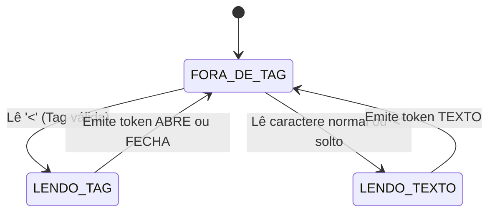
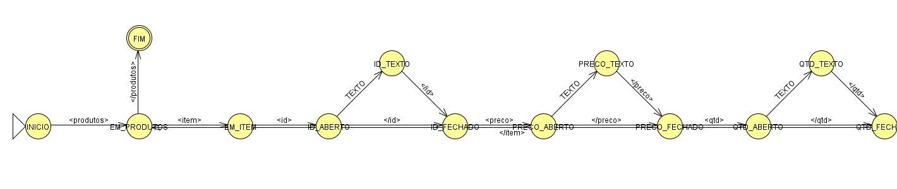
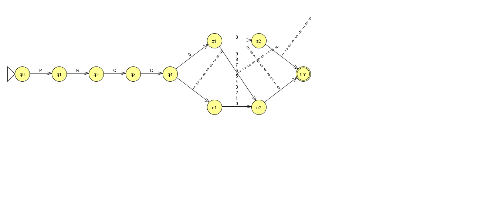
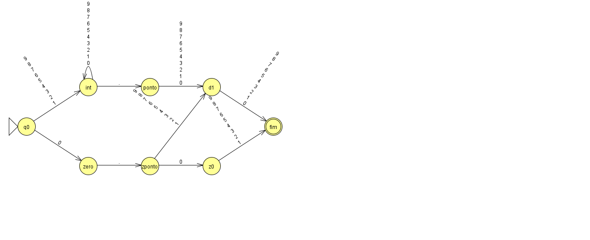
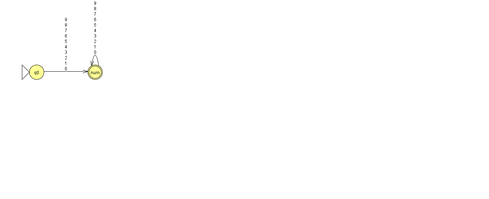

# Validador-de-Estrutura-XML-Plana
O objetivo é validar um arquivo XML que armazena itens de estoque de uma loja.

## Diagrama do Lexer (AFD)

## AFD da estrutura (estrutura.py)

## Validação de tipos (tipos.py)

Cada campo do item é validado por um AFD próprio, implementado com tabela de transições.
Qualquer transição que não aparece no diagrama leva a um estado de erro (a entrada é rejeitada).

### id
Aceita de PROD001 até PROD999. O PROD000 é rejeitado.

### preco
Exatamente duas casas decimais, valor mínimo 0.01 e sem zero à esquerda (ex: 007.50 é inválido).

### qtd
Só números inteiros, sem sinal e sem casas decimais. Aceita 0 e zero à esquerda (ex: 007).

